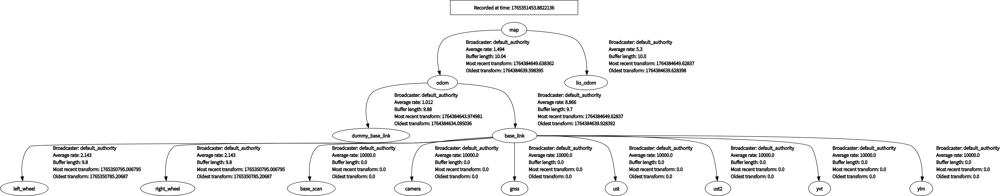
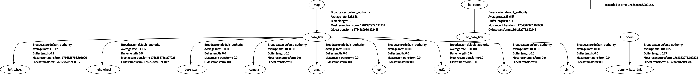

# lio_nav2_bringup

## 概要
- LIOベース2D Navigation実行環境
- Nav2からamclを削除
- simple_fastlio_localizationを利用し、3次元地図に対する自己位置推定→2次元に投影
- オドメトリをLIOに置換え

---
## 目次
- [lio\_nav2\_bringup](#lio_nav2_bringup)
  - [概要](#概要)
  - [目次](#目次)
  - [インストール](#インストール)
  - [Navigation2の起動](#navigation2の起動)
  - [座標系の設定について](#座標系の設定について)
  - [フレーム設定の一例](#フレーム設定の一例)
---

## インストール

```
cd <YOUR-ROS2-WORKSPACE>/src

git clone --recurse https://github.com/hokuyo-furo-org/lio_nav2_bringup/
cd ../
rosdep update
rosdep install --from-paths src/lio_nav2_bringup --ignore-src -r -y
colcon build --symlink-install
```

## Navigation2の起動
```
export $MAP_DIR=<地図のディレクトリ>

ros2 launch lio_nav2_bringup navigation_launch.py map:=$MAP_DIR/toyonaka.yaml
```
- パラメータ
  - map: 2D地図設定ファイル(yaml)
  - parmas_file: nav2設定ファイル (デフォルトは config/nav2_params.yaml)
- 目標位置の指定はrvizの「2D Goal Pose」から与えることができる


## 座標系の設定について
- 2D地図と3D地図の原点は一致することが前提
- /map -> /lio_odomは3次元座標での位置姿勢
- /map -> /odomは投影した2次元平面位置姿勢（Nav2用）
- /hokuyo3d /scanトピックもこの座標になる
- /base_linkは/hokuyo3d (Lidar)と一致
   - LIOからの3D位置姿勢を使う場合は座標変換に注意が必要
- オドメトリ（/odom -> /base_link）はLIOを使用する想定。車輪オドメトリを使用する場合はtf構成の修正が必要

## フレーム設定の一例
下記コマンドで確認
```
ros2 run rqt_tf_tree rqt_tf_tree
```

1. Localization でのナビゲーション時
map -> odom(lio_odomを2D化したフレーム) -> base_link の tree が必須
odom -> dummy_base_link は icart_mini_driver の tf tree (車輪オドメトリを使わないため)



2. GNSS切り替え 使用時
map -> base_link の tree が必須 lio_odom -> lio_base_link は、lioのtf tree (hokuyo_lio の tf は直接使わず、GNSS切り替え機能がmap -> base_link の tf を管理するため。)
odom -> dummy_base_link は icart_mini_driver の tf tree (車輪オドメトリを使わないため)

